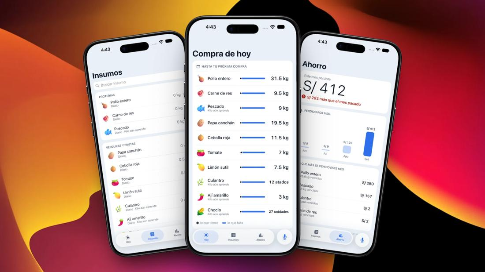

  

## About Me

<table>
<tr>
<td width="65%">

Backend Developer with experience building software for clients across different industries. I like to understand what each project needs, make well-grounded technical decisions, and build scalable, maintainable solutions that put long-term software quality first.

Want to see more of my work? Check out my portfolio → [danton-rm.vercel.app](https://danton-rm.vercel.app)

</td>
<td width="35%" align="center">

</td>
</tr>
</table>

## Featured Projects

<table>
<tr>
<td width="50%" valign="top">

<h3 align="center"><a href="https://github.com/JosepRivera/overload-server">🏋️ Overload</a></h3>

Strength-training platform that turns every logged set into data — volume moved, personal records, and estimated 1RM.

</td>
<td width="50%" valign="top">

<h3 align="center"><a href="https://kilo-docs-mu.vercel.app/producto/vision-general/">🥬 Kilo</a></h3>

Mobile app that helps small restaurants in Lima stop buying supplies "by eye" — voice logging, Holt-Winters demand forecasting, purchase recommendations, expiry alerts, and savings tracking.

</td>
</tr>
</table>

## Stats & Languages

  
  

## GitHub Activity

  

